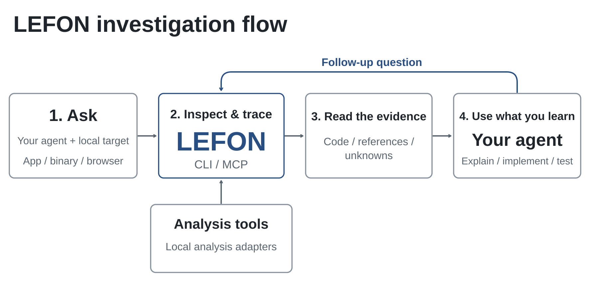

<div align="center">

[English](LEFONDME.md) · [简体中文](LEFONDME_zh.md) · [繁體中文](LEFONDME_zh-TW.md) · [日本語](LEFONDME_ja.md) · [한국어](LEFONDME_ko.md) · **Türkçe** · [Русский](LEFONDME_ru.md) · [Tiếng Việt](LEFONDME_vi.md) · [ไทย](LEFONDME_th.md) · [Deutsch](LEFONDME_de.md) · [Español](LEFONDME_es.md) · [Français](LEFONDME_fr.md) · [Українська](LEFONDME_uk.md) · [Polski](LEFONDME_pl.md) · [Português (Brasil)](LEFONDME_pt-BR.md) · [العربية](LEFONDME_ar.md) · [فارسی](LEFONDME_fa.md) · [Bahasa Indonesia](LEFONDME_id.md) · [Italiano](LEFONDME_it.md)

# LEFON: Her şeyi tersine mühendislikle inceleyin

### İkili dosyaların, uygulamaların ve çalışma zamanı davranışının tersine mühendisliği için tek bir MCP.

**Beğendiğiniz bir özellik mi gördünüz? İkili kod düzeyine kadar nasıl çalıştığını anlayın.**

[](https://www.npmjs.com/package/lefon-reverse-engineering)
[](https://github.com/mkbraion/lefon-reverse-engineering/actions/workflows/ci.yml)
[](docs/mcp-contracts.md#generated-catalog)
[](#current-status)
[](https://skills.sh/mkbraion/lefon-reverse-engineering/reverse-engineer-anything)
[](LICENSE)
[](https://discord.gg/GkcryMnJDM)

<a href="https://trendshift.io/repositories/82054?utm_source=repository-badge&amp;utm_medium=badge&amp;utm_campaign=badge-repository-82054" target="_blank" rel="noopener noreferrer"></a>

**[Web sitesi](https://mkbraion.github.io/lefon-reverse-engineering/) · [Rehberler](https://mkbraion.github.io/lefon-reverse-engineering/guides/) · [Örnek çalışmalar](https://mkbraion.github.io/lefon-reverse-engineering/showcase/)**

[Hızlı başlangıç](#hızlı-başlangıç) · [LEFON nasıl çalışır](#lefon-nasıl-çalışır) · [Neleri analiz edebilirsiniz](#neleri-analiz-edebilirsiniz) · [Örnek çalışmalar](#örnek-çalışmalar) · [Sık sorulan sorular](#sık-sorulan-sorular) · [Belgeler](#belgeler)

<code>npx lefon-reverse-engineering setup</code>

<br />


<br /><br />

<table aria-label="LEFON topluluğu">
<tr>
<td align="center" width="360">
  <a href="https://discord.gg/GkcryMnJDM">
    <br />
    <strong>Tersine mühendislik topluluğuna katılın</strong>
  </a><br />
  <sub>Discord · Soru-cevap · Sonuç paylaşımı</sub>
</td>
</tr>
</table>

<br />

</div>

---

Bir uygulamada kendi ürününüze eklemek istediğiniz bir özellik mi gördünüz? Ajanınızdan LEFON ile araştırmasını isteyin. Kaynak kodu olmadan uygulamayı inceleyebilir, özelliğin nasıl çalıştığını açıklayabilir, kanıtları gösterebilir ve projenize uygun bir sürümünü geliştirebilir.

LEFON, ajanınızı yerel makine kodu içeren ikili dosyaları, JavaScript ve Electron uygulamalarını, .NET derlemelerini ve web sitelerini inceleyen araçlara bağlar. Aynı araçları terminalden de kullanabilirsiniz. Analiz yerel olarak çalışır; sonuçlar her çıkarımın dayandığı kanıtları ve sınırlamaları içerir.

Kurulum, LEFON'yı ajanınıza kaydeder ve uyumlu iş akışı talimatlarını yükler. Yerel makine kodu analizi mevcut bir Hopper veya Ghidra kurulumunu kullanabilir; kurulum işlemi, onayınızla isteğe bağlı olarak Hopper da yükleyebilir. Statik JavaScript analizi bu iki motora da ihtiyaç duymaz.

> Kurulum talimatları, görselli rehberler ve gerçek örnek çalışmalar için **[LEFON web sitesini ziyaret edin](https://mkbraion.github.io/lefon-reverse-engineering/)**.

## Hızlı başlangıç

### Ajanınızı yapılandırın

Node.js ve npm yüklüyken şu komutu çalıştırın:

```bash
npx lefon-reverse-engineering setup
```

Ajanlarınızı seçin, önerilen değişiklikleri inceleyin ve onaylayın. Kurulum, mevcut yapılandırmaları yedekleyerek LEFON'nın MCP sunucusunu ve uyumlu iş akışı talimatlarını ekler. Ardından ajanınızı yeniden başlatın.

Kurulum Claude Code, Codex, Cursor, Gemini CLI, Grok Build ve [diğer ajanları](docs/installation.md#supported-agents) destekler. Sağlayıcı yapılandırması ve elle MCP kaydı için [yükleme ve kurulum](docs/installation.md) belgesine bakın.

### Ajanınıza sorun

```text
Notes uygulamasında aramanın nasıl çalıştığını araştır, kanıtları göster ve projem için benzer bir özellik geliştir.
```

Notes yerine hedef uygulamanızı ve anlamak istediğiniz özelliği belirtin.

### Terminali kullanın

Çıkarılmış bir JavaScript/Electron uygulama dizinini veya ASAR dosyasını inceleyin:

```bash
npx -y lefon-reverse-engineering@latest analyze-javascript-application /absolute/path/to/app --json
```

Sonuç; modülleri, içe aktarmaları, Electron sınırlarını ve bunlara ilişkin kanıtları içerir. Yolu hedefinizle değiştirin; Windows'ta örneğin `"D:/apps/example"` kullanabilirsiniz.

Düzenli kullanım için `lefon` komutunu yüklemek üzere:

```bash
npm install --global lefon-reverse-engineering
lefon --help
```

Yerel makine kodu analizi için önce bir sağlayıcı yapılandırın. Yerel analiz komutları, sağlayıcı seçimi, anlık görüntüler ve betik kullanımı için [CLI ve Evidence rehberine](docs/cli.md) bakın.

### LEFON'yı güncelleyin

LEFON hızla değişir ve yeni sürümler sık sık hata düzeltmeleri içerir. Kurulumunuzu güncel tutun.

npm ile yüklenen CLI için:

```bash
lefon update
```

Ajan kayıtlarını ve skill'i güncellemek için güncellemenin çıktısında gösterilen kurulum komutunu çalıştırın.

`npx` kullanıyorsanız ajan kurulumunu şu komutla güncelleyin:

```bash
npx lefon-reverse-engineering@latest setup
```

Kurulum değişikliklerini inceleyin ve ajanınızı yeniden başlatın. Tek seferlik CLI işlemleri için `npx lefon-reverse-engineering@latest` komutunun ardından istediğiniz komutu yazın.

## LEFON nasıl çalışır

Ajanınız, hedefi incelemek ve ilgili kodu izlemek için MCP üzerinden LEFON'yı çağırır. LEFON bulguları kanıtlarıyla birlikte döndürür. Ajan bunları takip soruları sormak, davranışı açıklamak veya bir uygulama yazıp test etmek için kullanır. CLI komutları aynı iş akışlarını kullanır.



[Şekli tam boyutuyla açın](website/public/assets/figures/lefon-investigation-flow.svg).

<a id="current-status"></a>

## Neleri analiz edebilirsiniz

LEFON; Node.js 22.x (>=22.19), 24.x (>=24.11) veya 26+ ve npm gerektirir. Ek araçlar ve desteklenen ana bilgisayar sistemleri hedefe bağlıdır:

| Hedef                                   | LEFON'nın döndürdükleri                                                                                       | Gereksinimler ve rehber                                                                                                                |
| --------------------------------------- | ----------------------------------------------------------------------------------------------------------- | -------------------------------------------------------------------------------------------------------------------------------------- |
| Yerel makine kodu içeren ikili dosyalar | Sözde kod, assembly kodu, dizeler, semboller, çağrılar ve referanslar                                       | Hopper, Ghidra veya IDA; [yerel kod analizi](https://mkbraion.github.io/lefon-reverse-engineering/guides/native/)                                                         |
| Çevrimdışı ELF yapısı                   | Bölümler, segmentler, özgün semboller/yeniden konumlandırmalar ve statik analizden olası güvenlik önlemleri | Linux x64 üzerinde çağıranın sağladığı pwntools; [ikili dosya tanılama](docs/binary-diagnostics.md)                                    |
| EVM bayt kodu                           | Yönlendirme seçicileri, bayt ofsetleri, çıkarımla belirlenen argümanlar ve durum değiştirilebilirliği       | Linux x64 üzerinde yerel ham bayt/onaltılık girdi; [çevrimdışı EVM rehberi](docs/evm-bytecode.md)                                      |
| Kaydedilmiş Linux çökmeleri             | Ham note kayıtları, kaydedilen her iş parçacığının yazmaçları/sinyalleri ve isteğe bağlı eşleme adayları    | Linux x64 üzerinde çağıranın sağladığı pwntools; isteğe bağlı GDB/pwndbg; [kaydedilmiş çökmeler](docs/recorded-crashes.md)             |
| JavaScript / Electron                   | Modüller, içe aktarmalar, kaynak haritaları, rotalar, IPC ve yerel eklenti ilişkileri                       | Node.js ve npm; [uygulama analizi](https://mkbraion.github.io/lefon-reverse-engineering/guides/javascript/)                                                               |
| Web siteleri                            | Sayfa yapısı, betikler, ağ gözlemleri ve istenen ekran görüntüleri                                          | Chrome ailesinden bir tarayıcı; [tarayıcı analizi](https://mkbraion.github.io/lefon-reverse-engineering/guides/browser/)                                                  |
| Kaydedilmiş ağ yakalamaları             | İstekler, yanıtlar, erişilebilir yük içerikleri ve kaynak konumları                                         | HAR; mitmproxy'nin kendi biçimindeki yakalamalar için Linux üzerinde mitmdump; [ağ yakalama rehberi](docs/web-network-captures.md)     |
| .NET derlemeleri                        | Meta veriler, CIL talimatları, bildirilmiş yerel bağımlılıklar ve derleme karşılaştırmaları                 | Statik inceleme; [yönetilen kod rehberi](docs/managed-code-analysis.md)                                                                |
| Android APK'leri                        | Manifest bildirimleri, sınıflar, tersine derlenmiş metotlar ve referanslar                                  | Linux/macOS/Windows x64 üzerinde arayüzsüz JADX ve tam bir JDK; [Android rehberi](docs/android-analysis.md)                            |
| Android cihazları                       | Cihazlar, paketler, süreçler, günlükler, dökümler, ekran görüntüleri ve APK/dosya aktarımları               | Çağıranın sağladığı adb (emülatör veya cihaz); [ADB rehberi](docs/adb-device-analysis.md)                                              |
| JEB projeleri                           | Motor destekli proje birimleri, artefakt özetleri ve tür/metot sözdekodu                                    | Çağıranın başlattığı, MCP sunan bir JEB istemcisi, LEFON_JEB_MCP_URL ile seçilir; [JEB rehberi](docs/jeb-analysis.md)                    |
| Android kaynakları                      | Çözülmüş manifest, dize tabloları, diller ve sürüm bilgileri                                                | Çağıranın sağladığı Apktool başlatıcısı; [kaynak rehberi](docs/apktool-resource-analysis.md)                                           |
| Donanım yazılımı                        | Bölgeler, çıkarma sonuçları ve yerel kod analizine devirler                                                 | Linux üzerinde Binwalk / Unblob; [donanım yazılımı rehberi](docs/firmware-analysis.md)                                                 |
| Paketler ve kaynaklar                   | Dosya envanterleri, özet değerleri, plist'ler, Apple paket yapısı ve çıkarılmış kaynaklar                   | [Artefakt ve JavaScript rehberi](docs/javascript-artifact-reconstruction.md), [Apple uygulamaları](docs/apple-application-analysis.md) |
| Süreç davranışı                         | Terminal çıktısı, etkileşimler, sonlanma ve dosya sistemi gözlemleri, çalıştırma karşılaştırmaları          | Yerel PTY ile Linux/macOS; [süreç yakalama](docs/process-capture.md)                                                                   |

Statik JavaScript ve .NET incelemesi, uygulamayı çalıştırmadan sağlanan dosyaları okur. Çalışma zamanı yakalaması, seçilen hedefi kullanıcı izinlerinizle çalıştırır veya onunla etkileşime girer; her çalışma zamanı rehberi etkilerini açıklar.

<a id="choosing-a-deep-analysis-provider"></a>

Yerel makine kodu içeren ikili dosya biçimleri ve ana bilgisayar desteği sağlayıcıya göre değişir. [Hopper ve Ghidra kurulumu](docs/installation.md#hopper), [IDA rehberi](docs/ida-provider.md) ve [Windows için deneysel Ghidra desteği](docs/windows-ghidra-p0.md) belgelerine bakın. Ghidra ayrıca [16 bit DOS analizini](docs/ghidra-dos.md) destekler. Sağlayıcı seçimi için [CLI rehberine](docs/cli.md#choose-a-provider) bakın. En son npm sürümünden sonra eklenen özellikler için [sürümlerde kullanılabilirliği](docs/installation.md#released-package-and-main) kontrol edin.

## Örnek çalışmalar

[](https://mkbraion.github.io/lefon-reverse-engineering/showcase/)

### DX-Ball: Sesin stereo konumlandırma hesabını yeniden oluşturma

Bir ses çağrısından konumu stereo konumlandırmaya dönüştüren yardımcı fonksiyona ilerleyin, talimatları inceleyin ve eksik sözde kodu C'ye dönüştürün. Yeniden oluşturulan kod, özgün x86 üzerinde 3.205 test durumunu geçer ve derlenmiş fonksiyonun 63 baytının tamamını yeniden üretir.

[Örnek çalışmayı okuyun](https://mkbraion.github.io/lefon-reverse-engineering/showcase/dx-ball/) · [Yeniden oluşturma deposu](https://github.com/N0zoM1z0/dx-ball)

### Notion: Electron pano köprüsünü izleme

İşleyici sürecin pano API'sini bulun, preload ve IPC üzerinden ana sürece kadar izleyin ve zengin pano biçimini inceleyin.

[Örnek çalışmayı okuyun](https://mkbraion.github.io/lefon-reverse-engineering/showcase/notion/)

### TH04: DOS mermi halkası hesabını geri çıkarma

Özgün PC-98 oyununun 16 bit talimatlarını inceleyin, sabit ve hedefe yönelik açı hesaplarını geri çıkarın ve yeniden oluşturulan C++ kodunu dönemin derleyici çıktısıyla karşılaştırın.

[Örnek çalışmayı okuyun](https://mkbraion.github.io/lefon-reverse-engineering/showcase/th04/) · [Yeniden oluşturma deposu](https://github.com/N0zoM1z0/th04)

LEFON'yı ilginç bir konuda kullandıysanız görmek isteriz. Hedefi, sorunuzu, LEFON'nın nasıl yardımcı olduğunu ve bulgularınızı bir [issue](https://github.com/mkbraion/lefon-reverse-engineering/issues) veya [pull request](https://github.com/mkbraion/lefon-reverse-engineering/pulls) ile paylaşın.

## Sık sorulan sorular

<details>
<summary><strong>Hangi ajanlar LEFON'yı kullanabilir?</strong></summary>

Yerel MCP sunucularını destekleyen her ajan LEFON'yı kullanabilir. Kurulum, [desteklenen ajanları](docs/installation.md#supported-agents) yapılandırır; diğer istemciler [elle MCP kaydını](docs/installation.md#mcp-registry) kullanabilir.

</details>

<details>
<summary><strong>Hopper, Ghidra veya IDA gerekiyor mu?</strong></summary>

Derin yerel kod analizi bunlardan birini kullanır. Statik JavaScript ve .NET incelemesi yerel analiz motoru olmadan çalışır. Kurulum onaydan sonra Hopper yükleyebilir; Ghidra ve IDA mevcut kurulumlarınızı kullanır. [Sağlayıcı kurulumuna](docs/installation.md#hopper) bakın.

</details>

<details>
<summary><strong>Önce Hopper'ı başlatmam gerekiyor mu?</strong></summary>

LEFON, bir işlem gerektirdiğinde Hopper'ı başlatır. macOS'ta ilk çalıştırmada demo modunu seçmenizi veya lisansınızı etkinleştirmenizi isteyen bir iletişim kutusu açılabilir. [Hopper başlatma ve sorun giderme](docs/installation.md#launcher-paths-and-troubleshooting) belgesine bakın.

</details>

<details>
<summary><strong>skills.sh üzerinden skill yüklemek ne yapar?</strong></summary>

Skill, ajanınıza araştırma talimatları sağlar. LEFON'nın MCP sunucusunu kaydetmek ve uyumlu talimatları yüklemek için `npx lefon-reverse-engineering setup` kullanın, ardından ajanınızı yeniden başlatın. [Yalnızca skill yükleme](docs/installation.md#skill-only-installation) belgesine bakın.

</details>

<details>
<summary><strong>LEFON hangi kodu döndürür?</strong></summary>

Yerel kod analizi sözde kod ve assembly kodu döndürür. JavaScript/Electron analizi modülleri ve aralarındaki ilişkileri geri çıkarır. Ajanınız bu bulgularla bir uygulama yazar ve test eder; [örnek çalışmalar](#örnek-çalışmalar) uygulamalı örnekler sunar.

</details>

<details>
<summary><strong>LEFON uygulamamı yükler mi?</strong></summary>

LEFON hedefleri yerel olarak analiz eder. Ajanınız araç sonuçlarını alır ve model sağlayıcısının kendi veri politikası vardır.

</details>

<details>
<summary><strong>Bir hatayla karşılaşırsam ne yapmalıyım?</strong></summary>

Önce güncelleyin; yakın tarihli bir sürüm hatayı düzeltmiş olabilir.

npm ile yüklenen CLI için:

```bash
lefon update
```

`npx` üzerinden ajan kurulumu için:

```bash
npx lefon-reverse-engineering@latest setup
```

Ajan kullanıyorsanız [kurulum yenilemesini](#reayı-güncelleyin) tamamlayın ve ajanı yeniden başlatın. Aynı görevi tekrar deneyin. Sorun sürerse LEFON sürümünüzü, hedef türünü, yeniden üretme adımlarını ve hata çıktısını içeren bir [issue açın](https://github.com/mkbraion/lefon-reverse-engineering/issues).

</details>

## Belgeler

Web sitesindeki [uygulamalı rehberlerden](https://mkbraion.github.io/lefon-reverse-engineering/guides/) başlayın. Kesin seçenekler, ön koşullar ve sonuç sözleşmeleri için:

- [Yükleme ve kurulum](docs/installation.md): ajan kaydı, sağlayıcı yapılandırması, güncellemeler ve kaldırma.
- [Hazırlık ve sorun giderme](docs/installation.md#check-readiness-for-your-task): belirli bir ajanı veya analiz motorunu tanılama.
- [CLI ve Evidence](docs/cli.md): komutlar, sağlayıcı seçimi, anlık görüntüler, içe/dışa aktarma ve çıkış durumları.
- [MCP sözleşmeleri](docs/mcp-contracts.md) ve [ajan istemleri](docs/mcp-prompts.md): araç sonuçları, oturumlar ve yönlendirmeli araştırmalar.
- [Araç kataloğu](docs/mcp-contracts.md#generated-catalog): derleme sırasında oluşturulan araç, sağlayıcı ve CLI komutu envanteri.
- [Yol haritası](docs/roadmap.md): planlanan çalışmalar ve yetenek takibi.

Güvenlik açıklarını [SECURITY.md](SECURITY.md) üzerinden bildirin.

## Yıldız geçmişi

🎉 **GitHub'da 50.000 yıldız — teşekkürler!**

LEFON'yı kullanan, hata bildiren, özellik talep eden, derlemeleri test eden ve düzeltmelere katkıda bulunan herkese teşekkürler.

<a href="https://www.star-history.com/?repos=mkbraion%2Flefon-reverse-engineering&amp;type=date">
  <picture>
    <source media="(prefers-color-scheme: dark)" srcset="https://api.star-history.com/chart?repos=mkbraion/lefon-reverse-engineering&amp;type=date&amp;theme=dark&amp;legend=top-left" />
    <source media="(prefers-color-scheme: light)" srcset="https://api.star-history.com/chart?repos=mkbraion/lefon-reverse-engineering&amp;type=date" />
    
  </picture>
</a>

## Sorumluluk reddi

LEFON, yasal tersine mühendislik araştırması, analizi ve yeniden oluşturma için araçlar sağlar. Gerekli izinleri almak ve geçerli yasalara uymak sizin sorumluluğunuzdadır. Proje yasa dışı veya yetkisiz kullanımı desteklemez.

## Katkıda bulunma

LEFON'ya katkınızı bekliyoruz! Hata bildirmek veya özellik önermek için bir [issue açın](https://github.com/mkbraion/lefon-reverse-engineering/issues); kodu veya belgeleri geliştirmek için bir [pull request gönderin](https://github.com/mkbraion/lefon-reverse-engineering/pulls).

Geliştirme ortamı ve kontroller için [CONTRIBUTING.md](CONTRIBUTING.md), doğrulama süreçleri için [test rehberi](docs/testing.md) ve proje yapısı için [mimari harita](docs/architecture.mermaid) belgelerine bakın.

## Lisans

[MIT](LICENSE)
